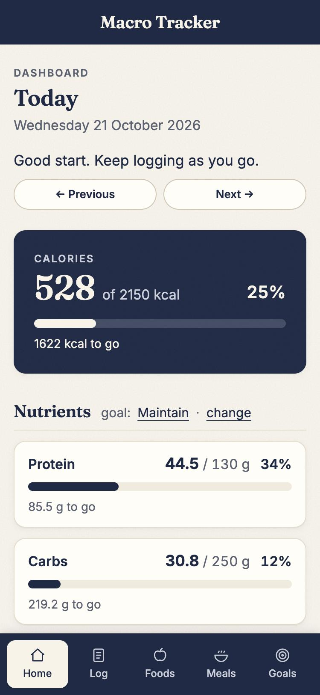
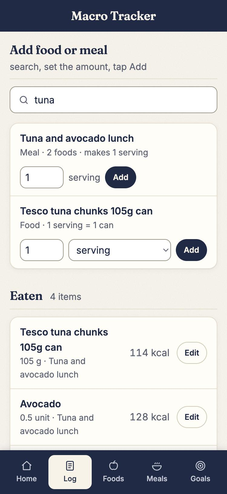
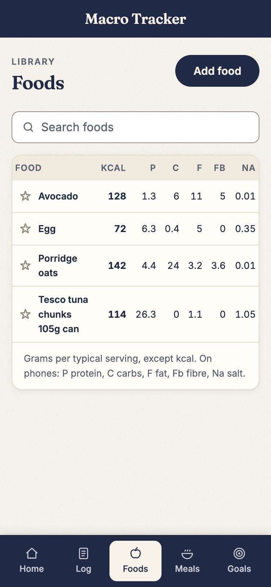
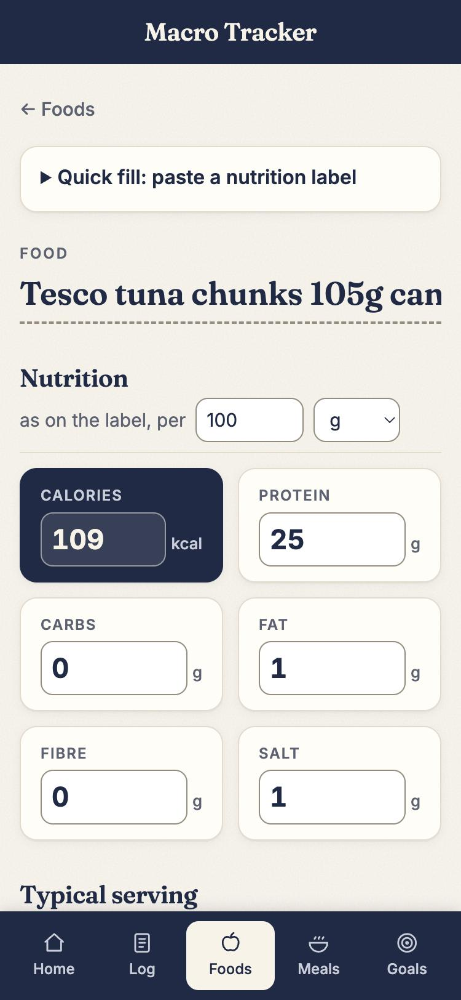
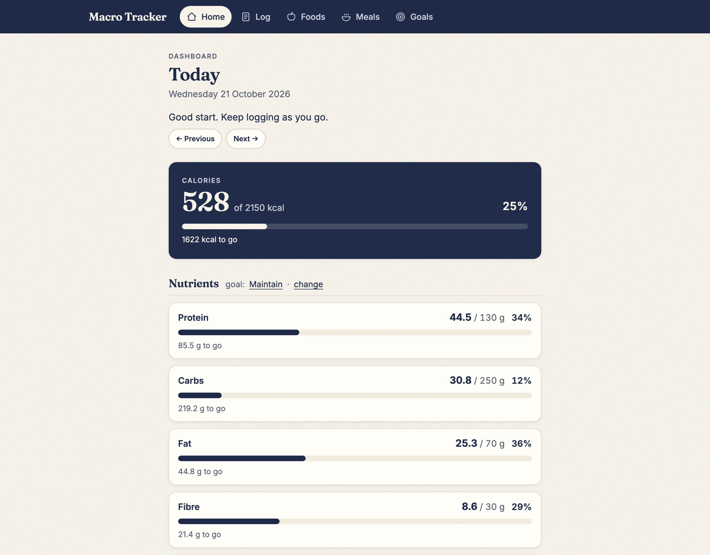

# Macro Tracker

A simple, phone-friendly web app for logging what I eat each day and comparing it with a daily goal for calories, protein, carbs, fat, fibre and salt. Single user, no login.

> **Warning: there is no login.** Anyone who has the URL can view and change the data. Do not share the URL. The site asks search engines not to index it (`noindex` and `robots.txt`), but that is not security.

<p>
  
  
  
  
</p>



## What it does

- **Dashboard** (home): today's calories and each nutrient against the active goal, with "to go", "on target" and "over" states, previous/next day, and the day's entries.
- **Log**: a page per day. Search foods and meals, set servings or an exact amount, tap Add. Each entry saves a snapshot of its nutrition, so editing a food later never rewrites history. Meals expand into one entry per food.
- **Foods**: the library. Values as printed on the label (per 100 g, per 1 unit…), a typical serving, a live per-serving preview, paste-a-label autofill, favourites.
- **Meals**: groups of foods with totals and per-serving figures.
- **Goals**: daily targets. Exactly one is active (enforced by the database); switching is one click.

## Stack

Flask (Python) with Jinja templates and HTMX, plain CSS (no build step), Supabase Postgres via SQLAlchemy and Flask-Migrate, hosted on Vercel. "Today" always means today in Europe/London.

## Run it locally

```bash
python3 -m venv .venv
source .venv/bin/activate
pip install -r requirements.txt
cp .env.example .env          # then fill in the values below
flask --app app db upgrade    # create or update the tables
flask --app app seed          # optional: sample foods, a meal and two goals (only if empty)
flask --app app run --debug   # http://127.0.0.1:5000
```

Run the tests with `pytest` (they use a throwaway in-memory database, not Supabase).

### Environment variables

| Name | What it is |
|---|---|
| `DATABASE_URL` | Supabase **Transaction pooler** connection string (Connect button, port **6543**, user `postgres.<project-ref>`). Not the direct connection: that one is IPv6-only and Vercel can't reach it. |
| `SECRET_KEY` | Any long random string. Signs the session cookie and CSRF tokens. Generate one with `python3 -c "import secrets; print(secrets.token_hex(32))"`. |

`.env` holds the real values and is git-ignored. `.env.example` is the committed template.

## Deploy (Vercel + Supabase)

1. **Supabase**: create a project, then copy the Transaction pooler string from **Connect**.
2. **Vercel**: import the GitHub repo (framework: Flask). Vercel finds the `app` object in `app.py` through `pyproject.toml` (`[tool.vercel] entrypoint = "app:app"`) and serves `public/` from its CDN.
3. In Vercel → Settings → Environment Variables, add `DATABASE_URL` and `SECRET_KEY` for Production and Preview.
4. Run migrations from your machine against the same database: `flask --app app db upgrade`.
5. Push to `main` to deploy production. Any other branch gets a preview URL.

Dependencies are listed in both `requirements.txt` (local, includes pytest) and `pyproject.toml` (what Vercel installs). Change both when adding a library.

## Folder tour

```
app.py                     Vercel entry point: app = create_app()
macrotracker/
  __init__.py              create_app(): config, extensions, blueprints, filters
  config.py                settings from environment variables (NullPool for serverless)
  models.py                Food, Meal, MealItem, Goal, LogEntry
  forms.py                 Flask-WTF forms
  errors.py                friendly 404 / 500 / "database unreachable" pages
  seed.py                  `flask seed`
  services/                the rules, as plain testable functions
    nutrition.py           macro maths
    log.py                 logging with snapshots, meal expansion
    goals.py               one active goal, transactional switch and delete
    dashboard.py           day totals (func.sum) and progress states
    dates.py               "today" in Europe/London
    label_parser.py        reads pasted nutrition labels
  blueprints/              routes: dashboard, log, foods, meals, goals
  templates/               Jinja pages; partials/ holds shared and HTMX fragments
public/                    static files (css/main.css, js/htmx.min.js, favicon)
migrations/                Alembic migrations
tests/                     pytest
docs/learning-notes.md     what each phase taught, phase by phase
```

## Future ideas

Barcode scanning, imports from a food database, login and accounts, charts over weeks, a mobile app, streaks and badges.
